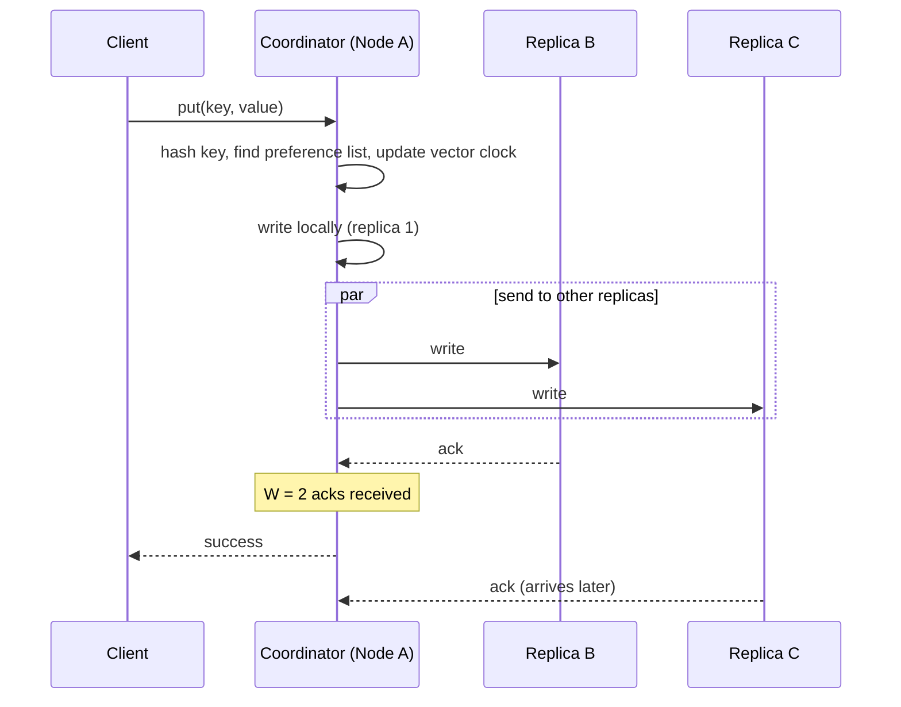

# Key-Value Store — High-Level Design

## Overview

This is a Dynamo-style distributed key-value store. It stores billions of small key-value pairs across many machines, with no master node, and stays available even when nodes fail.

**API**

- `put(key, value)` stores a value against a key.
- `get(key)` returns the value (or several versions, if there is a conflict).

Keys and values are small (key under 1 KB, value under ~10 KB).

**Goals**

| Goal | What it means | How it is achieved |
| --- | --- | --- |
| Scalability | Add machines to grow storage and throughput linearly | Consistent hashing, virtual nodes |
| De-centralization | No master or single point of failure; every node has the same role | Peer-to-peer gossip, any node can coordinate a request |
| Eventual consistency | Replicas may differ for a short time but converge | Quorum reads/writes, vector clocks, hinted handoff, Merkle trees |

In CAP terms the system is **AP**: during a network partition it stays available and accepts writes, then reconciles replicas later.

## 1. Partition

Data is split across nodes using **consistent hashing**, so adding or removing a node moves only about 1/N of the keys.

**Why not `hash(key) % N`?** When N changes (a node is added or dies), almost every key maps to a different node, and nearly all the data has to move.

**How consistent hashing works**

1. Picture the hash output space (for example 0 to 2^128 − 1) as a ring.
2. Hash each node's ID and place it on the ring.
3. Hash each key and place it on the ring.
4. Walk clockwise from the key; the first node you meet owns the key.

When a node joins, it takes over only the keys between itself and its counter-clockwise neighbour. When a node leaves, only its keys move to the next node clockwise.

**Virtual nodes (vnodes)**

With one position per node, the ring is uneven: some nodes get large ranges and become hot. The fix is to give each physical node many positions on the ring (for example 100–256 vnodes).

- Load spreads evenly across nodes.
- When a node fails, its load is shared by many nodes, not dumped on one neighbour.
- Heterogeneous hardware: a bigger machine gets more vnodes, so it takes more data.

## 2. Replication

Each key is stored on **N nodes** (typically N = 3) for durability and availability.

- After finding the key's position on the ring, walk clockwise and pick the first N **distinct physical nodes**. Skip vnodes that belong to a node already chosen, otherwise two copies could sit on the same machine.
- This ordered list of N nodes is the key's **preference list**. The first healthy node in it usually acts as the coordinator.
- For extra safety, place replicas in different racks or data centers, so one rack or DC failure cannot lose all copies.
- Replication is **asynchronous** beyond the write quorum W (next section): the client gets an ack once W replicas confirm, and the rest catch up.

## 3. Get & put operations

Any node can receive a request. The node that handles it is the **coordinator**: it hashes the key, finds the preference list and talks to the N replicas.

A put with N = 3 and W = 2: the client gets success as soon as two replicas confirm; the third catches up asynchronously.

**Quorum consensus (N, W, R)**

- N = number of replicas
- W = replicas that must acknowledge a write before it succeeds
- R = replicas that must answer a read before it returns
- If **R + W > N**, every read set overlaps every write set in at least one node, so a read sees the latest acknowledged write.

| Setting | Behaviour |
| --- | --- |
| N=3, W=2, R=2 | Balanced, strong-ish consistency (common default) |
| N=3, W=1, R=3 | Fast writes, slow reads |
| N=3, W=3, R=1 | Fast reads, slow writes |
| N=3, W=1, R=1 | Fastest, but only eventual consistency |

**Put (write path)**

1. Client sends `put(key, value, context)` to any node, which becomes the coordinator.
2. Coordinator generates a new vector clock for the value (see Data versioning).
3. Coordinator sends the write to all N replicas in the preference list.
4. Each replica appends to its **commit log** (write-ahead log) on disk, then updates its **memtable** in memory.
5. When W replicas acknowledge, the coordinator returns success to the client.
6. When a memtable fills, it is flushed to disk as an immutable, sorted **SSTable**. Background **compaction** merges SSTables and drops old versions.

**Get (read path)**

1. Client sends `get(key)` to any node (coordinator).
2. Coordinator asks the N replicas and waits for R responses.
3. Each replica checks its memtable, then uses a **Bloom filter** to skip SSTables that cannot contain the key, then reads the SSTable.
4. Coordinator compares the versions using vector clocks. If one is newer, it returns that one. If they are concurrent, it returns all versions (siblings) or applies last-write-wins.
5. Stale replicas are fixed in the background (**read repair**).

**Handling temporary failures: sloppy quorum + hinted handoff**

If a replica in the preference list is down, the coordinator writes to the next healthy node on the ring instead. That node stores the data with a **hint** ("this belongs to node X"). When X comes back, the hint is handed off and deleted. Writes never fail just because one replica is temporarily unreachable.

## 4. Data versioning

Because replicas accept writes independently, the same key can end up with different values on different replicas. **Vector clocks** detect whether two versions conflict.

**Vector clock** = a list of `[node, counter]` pairs attached to every value, e.g. `{A:2, B:1}`. When node X coordinates a write, it increments X's counter.

**Comparing two versions**

- **Descendant (no conflict):** every counter in V2 is ≥ the matching counter in V1. V2 has seen V1, so V2 wins and V1 is discarded.
  - `{A:1}` vs `{A:1, B:1}` → the second is newer.
- **Concurrent (real conflict):** some counters are bigger in V1 and others in V2. Neither has seen the other.
  - `{A:2}` vs `{A:1, B:1}` → conflict.

**Example**

1. Node A writes D1 → `{A:1}`
2. Node A updates it, D2 → `{A:2}` (D2 replaces D1)
3. During a partition, node B updates D2 → D3 `{A:2, B:1}`, and node C also updates D2 → D4 `{A:2, C:1}`
4. D3 and D4 are concurrent. A read returns both as **siblings**.
5. Client merges them (e.g. union of cart items) and writes D5 via node A → `{A:3, B:1, C:1}`, which supersedes both.

**Resolving conflicts**

| Approach | How | Trade-off |
| --- | --- | --- |
| Siblings to client (Dynamo) | Return all concurrent versions; the application merges them | No data loss, but client logic is more complex |
| Last-write-wins (LWW) | Vector clock detects the conflict; the higher wall-clock timestamp wins | Simple, but silently drops a write and depends on clock sync |
| CRDTs | Data types that merge automatically (counters, sets) | No loss, no client merge, limited to supported types |

**LWW catches:** clock skew can let an older write beat a newer one, and the losing write disappears without any error. Use it only for overwrite-style data (profile picture, session token, cache).

**Vector clock size:** the clock grows with every node that writes the key. Keep it bounded by dropping the oldest `[node, counter]` pair beyond a threshold (e.g. 10).

## 5. Gossip protocol

Nodes learn about each other and detect failures through **gossip**, so no central coordinator or ZooKeeper is needed.

**Why not all-to-all heartbeats?** If every node pings every other node, that is O(N²) messages, which does not scale to hundreds of nodes.

**How gossip works**

1. Each node keeps a **membership list**: node ID, heartbeat counter, last-updated time.
2. Each node periodically increments its own heartbeat counter.
3. Every second or so, a node sends its membership list to a few **random** nodes.
4. The receiver merges the list, keeping the higher heartbeat counter for each node.
5. Information spreads like a rumour and reaches all nodes in about O(log N) rounds.

**Failure detection**

- If a node's heartbeat counter has not increased for a set time (e.g. 10 seconds), it is marked **suspected**.
- A node is declared down only when several other nodes agree, which avoids false alarms from one bad link.
- Short outages are handled by hinted handoff. A permanently dead node is removed from the ring, and its ranges are re-replicated.

Gossip also spreads ring metadata (which node owns which token ranges), so every node can route any request.

## 6. Merkle tree

Merkle trees let two replicas find out **which keys differ** while exchanging only a few hashes, instead of comparing every key. This is called **anti-entropy**, and it repairs replicas after permanent failures or long outages, when hinted handoff is not enough.

**Building the tree (per key range on each node)**

1. Split the key range into buckets (e.g. 1–1000, 1001–2000, …).
2. Hash every key-value pair in a bucket, then hash those together to get the bucket hash. These are the **leaves**.
3. Each parent node = hash of its children's hashes.
4. The **root hash** summarises the whole range.

**Syncing two replicas**

1. Compare root hashes. If equal, the replicas are identical: done.
2. If not, compare the children and go down only into the subtrees whose hashes differ.
3. At the leaves, you have the exact buckets that are out of sync. Transfer only those keys.

Data transferred is proportional to the **differences**, not to the total data size. Comparing two trees takes O(log n) steps per differing bucket.

**Trade-off:** trees must be rebuilt when key ranges change (for example, a node joins), which costs CPU and disk I/O. Repairs are usually run in the background on a schedule.

## Summary

| Problem | Technique | Goal served |
| --- | --- | --- |
| Store huge data across machines | Consistent hashing + virtual nodes | Scalability |
| Survive node failures | Replication to N distinct nodes | Availability |
| Tune consistency vs latency | Quorum (R + W > N) | Eventual consistency |
| Concurrent writes on different replicas | Vector clocks (+ siblings or LWW) | Eventual consistency |
| Temporary node outage | Sloppy quorum + hinted handoff | Availability |
| Permanent divergence between replicas | Merkle trees (anti-entropy) | Eventual consistency |
| Membership and failure detection | Gossip protocol | De-centralization |
| Fast writes on each node | Commit log + memtable + SSTables | Scalability |

## Interview questions & answers

### Partitioning

**Q1. Why consistent hashing instead of `hash(key) % N`?**

With modulo hashing, changing N remaps almost every key, so nearly all data moves. With consistent hashing, a node join or leave moves only the keys in one range, about 1/N of the data.

**Q2. What problem do virtual nodes solve?**

With one position per node, ranges are uneven and some nodes become hot. Vnodes give each node many small ranges, so load is even, a failed node's load spreads across many nodes, and bigger machines can take more vnodes.

**Q3. How do you handle a hot key (e.g. a celebrity profile)?**

Consistent hashing alone doesn't fix it, because one key always maps to one preference list. Options: cache it in front of the store, read from any replica (R=1), or split the key into sub-keys (`key#1`…`key#k`) and merge on read.

### Replication & quorum

**Q4. Why must the N replicas be distinct physical nodes?**

With vnodes, the next N positions on the ring may belong to the same machine. If that machine dies, every copy is lost. So the preference list skips vnodes of already-chosen machines, ideally across racks or data centers too.

**Q5. What does R + W > N guarantee?**

Any read quorum and write quorum overlap in at least one replica, so a read contacts at least one node with the latest acknowledged write. It does not give full linearizability: sloppy quorum and concurrent writes can still produce stale or conflicting reads.

**Q6. How would you configure N, R, W for a read-heavy vs write-heavy system?**

Read-heavy: N=3, R=1, W=3 (fast reads, slow writes). Write-heavy: N=3, W=1, R=3. Balanced default: N=3, R=2, W=2. Lower R or W means lower latency but weaker consistency.

**Q7. What is a sloppy quorum and hinted handoff?**

If a replica in the preference list is down, the write goes to the next healthy node on the ring, which stores it with a hint naming the intended owner. When the owner recovers, the data is handed back. This keeps writes available during temporary failures.

**Q8. What happens if the coordinator crashes after writing to only one replica?**

The client sees a timeout and retries; the retry may land on another coordinator. The partial write may survive on one replica and spread later through read repair or anti-entropy. That is why writes should be idempotent or versioned.

### Consistency & versioning

**Q9. Is this system CP or AP? Why?**

AP. During a partition it keeps accepting reads and writes on both sides, then reconciles with vector clocks, hinted handoff and Merkle trees. A shopping cart or session store prefers availability over strict consistency.

**Q10. How do vector clocks detect a conflict?**

Compare counters node by node. If every counter in V2 is ≥ V1, V2 descends from V1 and replaces it. If each version has some counter bigger than the other, they are concurrent: a real conflict.

**Q11. A read gets two concurrent versions. What do you do?**

Either return both as siblings and let the client merge them (Dynamo, e.g. union of cart items, then write back with the merged clock), or apply last-write-wins using timestamps, or use CRDTs that merge automatically.

**Q12. What are the risks of last-write-wins?**

It silently drops one of the concurrent writes, and clock skew can let an older write win. Use it only for overwrite-style data such as a profile picture, session token or cache entry.

**Q13. Vector clocks can grow forever. How do you bound them?**

Keep at most a fixed number of `[node, counter]` pairs (e.g. 10) with a timestamp each, and drop the oldest when the limit is hit. This can rarely cause a false conflict, which is acceptable.

### Failure handling

**Q14. How does a node find out another node is down without a master?**

Gossip. Each node increments its heartbeat and periodically sends its membership list to a few random nodes. If a node's heartbeat stops increasing for a timeout, it is suspected, and declared down once several nodes agree.

**Q15. Why gossip instead of all-to-all heartbeats?**

All-to-all is O(N²) messages per round. Gossip sends a constant number per node per round and still reaches everyone in about O(log N) rounds.

**Q16. Hinted handoff vs Merkle trees: when is each used?**

Hinted handoff covers short, temporary outages. Merkle trees (anti-entropy) cover permanent failures or long outages, when hints were lost or expired and replicas have drifted apart.

**Q17. How do Merkle trees reduce sync cost?**

Replicas compare root hashes first. If they differ, they descend only into child subtrees whose hashes differ, down to the out-of-sync buckets. Data sent is proportional to the differences, not the total data size.

### Storage engine

**Q18. Why use an LSM tree (commit log + memtable + SSTables)?**

Writes are sequential appends plus an in-memory update, so they are very fast. The commit log gives durability if the node crashes before the memtable is flushed.

**Q19. How is a read kept fast when data is spread over many SSTables?**

Check the memtable first, then use a Bloom filter per SSTable to skip files that cannot contain the key, then the SSTable's sparse index. Compaction keeps the number of SSTables low.

**Q20. How are deletes handled?**

A delete writes a tombstone marker instead of removing data, so the delete itself can replicate. Compaction drops the tombstone and old values after a grace period, long enough for all replicas to see it; otherwise a stale replica could resurrect the key.
